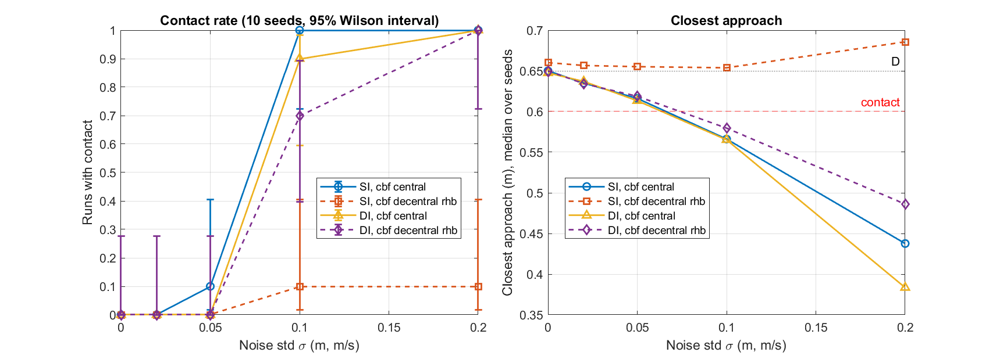
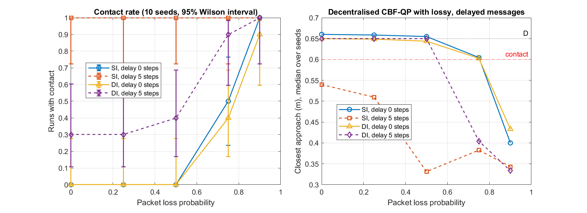
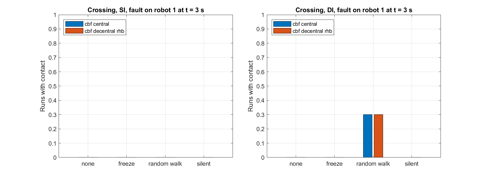
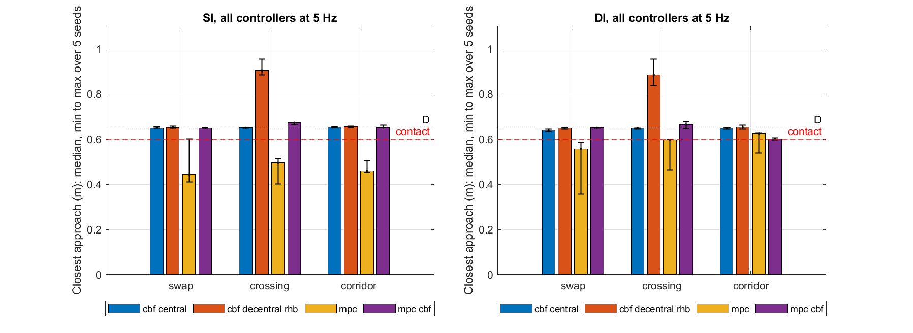
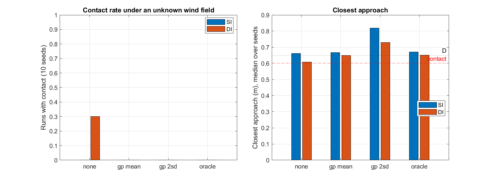
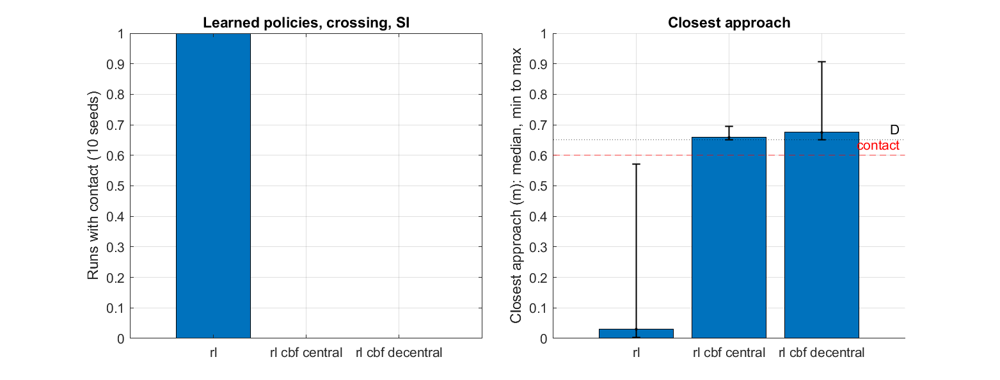
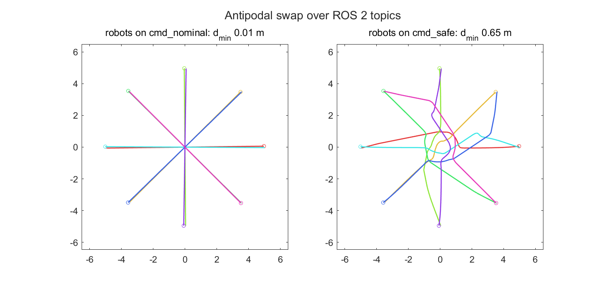

<h1 align="center">SafeSwarm</h1>

<p align="center">
  Safe multi-robot control in MATLAB: drop robots with bounded inputs into a scene,
  pick a controller, wrap it in a control barrier function safety filter, and measure
  what actually happens.
  <br>
  Grown from my <a href="https://github.com/Arshiagosh/SwarmSim">SwarmSim</a> simulator.
</p>

<p align="center">
  
  
  
  
  
</p>

<p align="center">
  
  &nbsp;
  
</p>

<p align="center"><sub>
  Left: eight robots swap to the opposite side of a circle through the centralised CBF-QP filter.
  Right: displacement-based formation of six double integrators over a ring graph.
</sub></p>

---

## What's in here

SafeSwarm keeps SwarmSim's layered design (dynamics → swarm and engine → behaviours and
planners → tools) and adds what a safety study needs:

- **Explicit input bounds.** Single integrator (‖u‖ ≤ v<sub>max</sub>), double integrator
  (‖u‖ ≤ a<sub>max</sub>, optional speed limit) and unicycle (box on v, ω). Every model has an
  exact zero-order-hold step and a control-affine form ẋ = f(x) + g(x)u for the filters.
- **Collisions are measured, not hidden.** SwarmSim pushed robots out of walls and obstacles. Here
  `contact_mode = 'none'` leaves the state alone and the logger records the closest approach,
  obstacle clearance, collision steps and control effort.
- **A CBF-QP safety filter** (`safety/SafetyFilter.m`) that wraps any behaviour:
  - pairwise and obstacle barriers h = ‖p<sub>i</sub> − p<sub>j</sub>‖² − D²,
  - relative degree one for the single integrator, a high-order CBF (Xiao and Belta, 2019) plus a
    speed barrier for the double integrator, and a look-ahead point for the unicycle,
  - **centralised** (one QP) or **decentralised** (one QP per robot, each keeping half of every
    pairwise constraint, after Wang, Ames and Egerstedt, 2017),
  - input bounds as hard constraints, and an explicit infeasibility count: when the bounds and the
    barriers conflict, the QP is solved again with a slack and the step is logged. It never falls
    back to the nominal command silently.
- **A sampled-data mode** in the engine: the controller runs every T seconds and its command is
  held while the dynamics keep integrating, to see what a continuous-time certificate is worth
  on a digital controller.
- **Uncertainty and faults**: sensor noise, lossy and delayed messages that the decentralised
  filter really acts on, faulty robots, and a seeded Monte Carlo runner.
- **Planning and learning**: a distributed nonlinear MPC planner, a Gaussian-process model of
  an unknown disturbance that corrects and tightens the filter, and a learned (Q-learning) policy
  with the filter on top.
- **A ROS 2 bridge**: the filter (or any behaviour) runs as a node between controllers and robots.
- **Benchmarks** that write `results.json` and every figure in this README from a script, and
  one command, `safeswarm_bench`, to rerun them.

The maths is on one page in [docs/SAFETY.md](docs/SAFETY.md), and the code layout in
[docs/ARCHITECTURE.md](docs/ARCHITECTURE.md).

## Results

All numbers below come from the scripts in `experiments/` and `ros2/` (MATLAB R2023b) and are
stored in [results.json](results.json). Robots have radius 0.3 m, so they
touch at 0.6 m; the filter keeps D = 0.65 m between centres. Speeds are bounded by 1 m/s and
accelerations by 1 m/s². Starts get a 5 cm random offset (seed 1) to break exact symmetry.

### E1: five controllers on three scenes

<p align="center">
  
  
</p>

Closest approach (m) and whether every robot reached its goal within 40 s:

| Scene | Dynamics | Nominal | Potential field | CBF centralised | CBF decentralised | CBF decentralised + right-hand bias |
|---|---|---|---|---|---|---|
| Swap (8) | SI | 0.006, all | 0.208, all | 0.650, all | 0.650, **0 of 8** | 0.650, all |
| Swap (8) | DI | 0.006, all | 0.005, all | 0.649, all | 0.641, all | 0.650, all |
| Crossing (8) | SI | 0.024, all | 0.156, all | 0.650, all | 0.650, all | 0.885, all |
| Crossing (8) | DI | 0.024, all | 0.025, all | 0.650, all | 0.650, all | 0.885, all |
| Corridor (6) | SI | 0.021, all | 0.111, all | 0.651, all | 0.650, **0 of 6** | 0.654, all |
| Corridor (6) | DI | 0.030, all | 0.008, all | 0.650, all | **0.536**, 3 of 6 | 0.650, all |

What the table says:

- The nominal go-to-goal controller and SwarmSim's potential field both collide in every scene.
  The potential field's gains were not tuned per scene, so treat it as a reference point, not a
  best effort.
- The centralised filter kept D (to within 1 mm) in every case and every robot arrived, at the cost of a longer
  trip (for example 13.3 s instead of 10.6 s for the single-integrator swap).
- **Deadlock.** The decentralised filter is safe but in the symmetric swap and in the corridor the
  single-integrator robots stop short of their goals with every constraint satisfied. The
  right-hand-bias heuristic (an extra sideways push on the nominal command when another robot is
  near) got them all through in these runs. It is a heuristic, not a guarantee.
- **Infeasibility is real.** With a 1 m/s² bound the decentralised double-integrator filter could
  not satisfy its constraints on 66 steps in the swap and 84 in the corridor. In the corridor that
  ended in contact: the closest approach was 0.536 m and 50 logged steps had two robots overlapping.
  The centralised filter had no infeasible steps in E1.

Mean filter time per control step was 7 to 15 ms for the centralised filter (one QP over up to
16 variables) and 3 to 6 ms for all the decentralised QPs together, on my laptop.

### E2: the same filter on a digital controller

<p align="center">
  
</p>

The CBF condition is written for a command that changes continuously. Holding each command for
T seconds (dynamics integrated at 2 ms) and changing nothing else:

- single integrator: the closest approach stayed at D for T up to 0.5 s and dropped to 0.36 m (swap)
  and 0.42 m (crossing) at T = 1 s;
- double integrator: it started to fall earlier, 0.613 m at T = 0.4 s in the swap, contact at
  T = 0.5 s (0.586 m), and 0.078 m at T = 1 s.

So the certificate depends on the sampling period and nothing in a standard CBF-QP filter
accounts for it. My MSc thesis works on exactly this; that part is not in this repository yet.

### E3: noise, lossy messages and a faulty robot (Monte Carlo)

Each setting below is 10 seeded runs (`uncertainty/MonteCarloRunner.m`); "contact rate" is the
share of runs in which two robots overlapped at least once, with a 95 % Wilson interval in the
figures. Ten runs per point is enough to see trends, not to pin down small rates.

<p align="center">
  
</p>

**Sensor noise** (`e3a_noise.m`, swap scene). Every controller sees positions, and velocities for
the double integrator, with Gaussian noise of std σ, and the 5 cm margin is left as it is. At
σ = 0.02 no run made contact. At σ = 0.1 the centralised filter made contact in 10 of 10 runs (SI)
and 9 of 10 (DI), and the decentralised filter in 7 of 10 (DI). The single-integrator decentralised
filter with the right-hand bias was the exception: 1 contact in 10 runs at both σ = 0.1 and 0.2.
Only the 5 cm margin stands between a noisy measurement and contact, and it was not sized for
noise.

<p align="center">
  
</p>

**Lossy, delayed messages** (`e3b_comm.m`, swap scene, decentralised filter). Each robot builds
its constraints from the last state it received from each neighbour. Without delay, losing up to
half of the messages caused no contact; at 75 % loss, 5 of 10 (SI) and 4 of 10 (DI) runs made
contact, and at 90 %, 10 and 9 of 10. A delay of 5 control steps (0.25 s) hurt even with no loss at
all: every single-integrator run and 3 of 10 double-integrator runs made contact.

<p align="center">
  
</p>

**One faulty robot** (`e3c_faults.m`, crossing scene, fault on robot 1 from t = 3 s). A frozen
robot was avoided in every run, and so was a silent one (still driving, no messages). A robot that
wanders at full speed and ignores its filter led to contact in 3 of 10 runs for the double
integrator with either filter, and in none for the single integrator. In every fault case the
seven healthy robots reached their goals, except with the wandering robot under the decentralised
double-integrator filter (6.8 of 7 on average).

### E4: MPC against the filters, and a learned disturbance model

<p align="center">
  
</p>

**Distributed MPC** (`e4a_mpc_vs_cbf.m`, 5 seeds per cell, every controller at 5 Hz). Each robot
solves a 10-step (2 s) nonlinear MPC with `fmincon` and avoids its neighbours' plans from the
previous step (`mpc/NMPCPlanner.m`). On its own it made contact in most runs: 4 of 5 (swap), 5 of 5
(crossing) and 5 of 5 (corridor) for the single integrator, 5, 5 and 1 of 5 for the double
integrator. Its constraints hold only at the 0.2 s sample points and against plans that are one step
old, and two robots closing at 2 m/s cover 0.4 m between samples. Putting the decentralised CBF
filter on top removed contact in every swap and crossing run and in the single-integrator corridor;
in the double-integrator corridor 2 of 5 runs still touched (closest 0.598 m), with about 20
infeasible filter steps per run. The MPC also got stuck more often than the go-to-goal filters
(none of the six corridor robots arrived with MPC plus filter, single integrator). The centralised
filter on go-to-goal had no contact in any of the 30 runs. One control call for all eight robots
took 13 to 32 ms with MPC alone (up to 49 ms with the filter on top) and 3 to 16 ms with the
filters. This is a plain MPC with no
inter-sample or deadlock handling, so read it as a baseline, not as the best MPC can do.

<p align="center">
  
</p>

**Unknown wind and a GP model of it** (`e4b_gp_residual.m`, swap scene, centralised filter, 10
seeds). Every robot is pushed by the same position-dependent field (a swirl plus a steady push,
up to about 0.5 in input units) that the filter does not know. A Gaussian process
(`mpc/GPResidual.m`, `fitrgp`) is trained per seed on 400 samples from 20 s of the robots wandering
in the field; its mean error over the swap area was 0.053 (single integrator) and 0.029 (double
integrator). Without a model, the double-integrator robots made contact in 3 of 10 runs. With the
GP mean, the GP mean plus two standard deviations, or the true field, none did; the 2σ margin kept
them further apart (median closest approach 0.729 m against 0.649 m with the mean). The single
integrator made no contact even without a model. No robot ended within 0.2 m of its goal in this
experiment, because the go-to-goal controller has a steady offset in the wind; that is the nominal
controller, not the filter.

**Unicycles** (`e4c_unicycle_mpc.m`, swap and crossing, 5 seeds, 5 Hz). The MPC also plans for
unicycles, with an exact arc rollout and finite-difference gradients. On its own it made contact in
5 of 5 swap runs and 3 of 5 crossing runs. With the decentralised filter on top, and with the
centralised filter on go-to-goal, there was no contact, but robots often stopped short of their
goals (on average 0 of 8 in the swap, and 2.6 and 6.4 of 8 in the crossing): the filter acts on a point 0.2 m ahead of each robot and so asks for 1.05 m between those
points, more than the 1 m between neighbouring crossing goals, and the swap deadlocked. One MPC
call for eight unicycles took 33 to 97 ms (up to 132 ms with the filter).

### E5: a learned policy with a safety filter on top

<p align="center">
  
</p>

`e5_rl_shield.m`: each of the eight crossing robots learns its own tabular Q-learning policy alone
(`learning/QLearningPolicy.m`, independent Q-learning on a 1 m grid, 5000 episodes), so the policies
know nothing about each other. Run together for 10 seeds, the learned policies made contact in
every run (median closest approach 0.030 m). With the centralised or the decentralised CBF filter
on top there was no contact in any run, and on average 7.2 and 7.0 of the 8 robots reached their
goals (7.7 without the filter), taking about 3 to 4 s longer. The policy is deliberately simple; the
point is that the filter does not care where the nominal command comes from.

### ROS 2: the filter as a node

<p align="center">
  
</p>

`ros2/` runs any SafeSwarm behaviour, or the filter around commands from any other node, as a
ROS 2 node (MATLAB ROS Toolbox). Each robot has `<ns>/odom` (nav_msgs/Odometry),
`<ns>/cmd_nominal` and `<ns>/cmd_safe` (stamped Twist, or Accel for double integrators).
`ros2/demo_ros2_swap.m` runs three nodes that only talk over topics: eight simulated robots, a
go-to-goal controller and the centralised filter. With the robots listening to `cmd_nominal` the
closest approach was 0.009 m; with them listening to `cmd_safe` it was 0.650 m and no step had
contact. Everything ran on one machine with simulated robots; it has not been tried on hardware.

## Running it

MATLAB R2023b (older releases will probably work but are untested). The core needs base MATLAB;
`SafetyFilter` and `NMPCPlanner` need the Optimization Toolbox (`quadprog`, `fmincon`) and
`GPResidual` the Statistics and Machine Learning Toolbox (`fitrgp`); each says so if it is missing.

```matlab
cd SafeSwarm
startup                                  % adds everything to the path
safeswarm_bench('quick')                 % tests + E1 + the swap GIF, a few minutes
safeswarm_bench('full')                  % every experiment (hours: Monte Carlo and MPC runs)
run('scenarios/scenario_swap_cbf.m')     % swap with and without the filter, prints the closest approach
run('tests/run_tests.m')                 % 51 unit tests
run('experiments/e1_benchmarks.m')       % E1 table, figures and swap GIF (a few minutes)
run('experiments/e2_sampled_sweep.m')    % E2 sweep (takes longer: 2 ms steps)
run('experiments/e3a_noise.m')           % E3 Monte Carlo sweeps (each takes a while)
run('experiments/e3b_comm.m')
run('experiments/e3c_faults.m')
run('experiments/e4a_mpc_vs_cbf.m')      % E4 (MPC runs take a while)
run('experiments/e4b_gp_residual.m')
run('experiments/e4c_unicycle_mpc.m')
run('experiments/e5_rl_shield.m')
run('ros2/demo_ros2_swap.m')             % needs the ROS Toolbox
```

A filter around your own behaviour:

```matlab
nominal = GoToGoal(goals);                               % or Flocking, DisplacementFormation, ...
safe    = SafetyFilter(nominal, 'Mode', 'decentralised');
sim     = SimEngine(swarm, env, safe, 0.05, 30);
sim.contact_mode   = 'none';                             % keep collisions visible
sim.control_period = 0.2;                                % optional zero-order hold
sim.logger         = DataLogger();
sim.run();
sim.logger.summary()                                     % closest approach, collisions, effort
safe.n_infeasible                                        % steps where the QP needed slack
```

Uncertainty wraps around the same stack:

```matlab
safe.comm = CommChannel(Inf, 0.3, 2);                    % 30 % packet loss, 2-step delay (decentralised)
behav = FaultInjector(safe, struct('agent', 1, 'mode', 'freeze', 't_start', 3));
behav = NoisyObservation(behav, 0.05, 0.05);             % position / velocity noise std
rows  = MonteCarloRunner.run(@(seed) my_case(seed), 1:20);
```

SafeSwarm can also be installed as a MATLAB toolbox: `tools/package_toolbox` builds
`release/SafeSwarm.mltbx`; double-click it, or `matlab.addons.install('release/SafeSwarm.mltbx')`.

The SwarmSim scenarios (`scenarios/scenario_*.m`) still run unchanged:
`run('tests/run_all_scenarios.m')`.

## Repository layout

```
dynamics/       SingleIntegrator, DoubleIntegrator, Unicycle (bounds, exact steps, f and g)
core/           Agent, Swarm, Environment, DynamicObstacle, CommChannel, SimEngine, DataLogger
behaviours/     SwarmSim behaviours + DisplacementFormation, GoToGoal, FunctionBehaviour
planners/       AStar, RRT, PotentialField
safety/         SafetyFilter (CBF-QP, centralised and decentralised)
uncertainty/    NoisyObservation, FaultInjector, MonteCarloRunner
mpc/            NMPCPlanner (distributed NMPC), GPResidual, FunctionResidual
learning/       QLearningPolicy (independent tabular Q-learning)
ros2/           BehaviourNode, TopicCommand, SimRobotsNode, RosTopics, demo_ros2_swap.m
tools/          MetricsAnalyzer, ExperimentRunner, ParamSweep, PublicationPlot
visualization/  SwarmVisualizer (with GIF export)
scenarios/      runnable examples
experiments/    E1 to E5; each writes figures/ and results.json
tests/          matlab.unittest suites, run_tests.m, run_all_scenarios.m
docs/           SAFETY.md, ARCHITECTURE.md
safeswarm_bench.m   one command for tests and experiments
```

## Changes from SwarmSim

Besides the new parts above, porting the core turned up a few things that are fixed here:

- `PathFollowing` could pick a waypoint behind the robot and turn it around.
- `VirtualStructure` advanced its centre by a hard-coded 0.05 s per call (only right for
  dt = 0.05) and had no velocity damping for double integrators, so robots oscillated about their
  slots.
- The double integrator used a semi-implicit Euler step; it is now the exact zero-order-hold
  solution.

## Limitations and what's next

- Deadlock and infeasibility are reported, not solved.
- Barriers on rectangles use the closest point, which is not smooth at corners.
- The scenes are small (6 to 8 robots). E1 and E2 are single seeded runs; E3 uses 10 seeds per
  setting, which shows trends but gives wide intervals.
- The noise and delay results use the filter as it is; nothing in it accounts for noise or delay.
- For unicycles the filter's look-ahead point makes it conservative (see E4).

Next: a Python port in `python/` of this repository, checked against the MATLAB results.

## Citing

If SafeSwarm is useful in your work, see [CITATION.cff](CITATION.cff).

## References

- A. D. Ames, S. Coogan, M. Egerstedt, G. Notomista, K. Sreenath and P. Tabuada, "Control barrier
  functions: theory and applications", *European Control Conference*, 2019.
- L. Wang, A. D. Ames and M. Egerstedt, "Safety barrier certificates for collisions-free multirobot
  systems", *IEEE Transactions on Robotics* 33(3), 2017.
- W. Xiao and C. Belta, "Control barrier functions for systems with high relative degree",
  *IEEE Conference on Decision and Control*, 2019.
- K.-K. Oh, M.-C. Park and H.-S. Ahn, "A survey of multi-agent formation control",
  *Automatica* 53, 2015.
- C. W. Reynolds, "Flocks, herds and schools: a distributed behavioral model", *SIGGRAPH*, 1987.

## License

MIT, see [LICENSE](LICENSE).

---

Arshia Goshtasbi · MSc Electrical Engineering (Control), Iran University of Science and Technology
