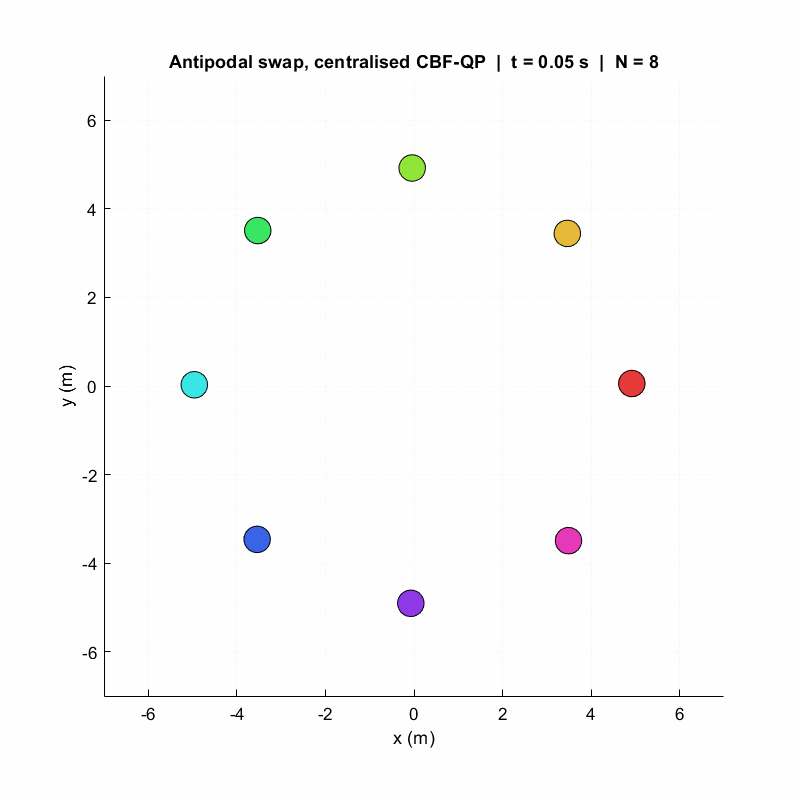
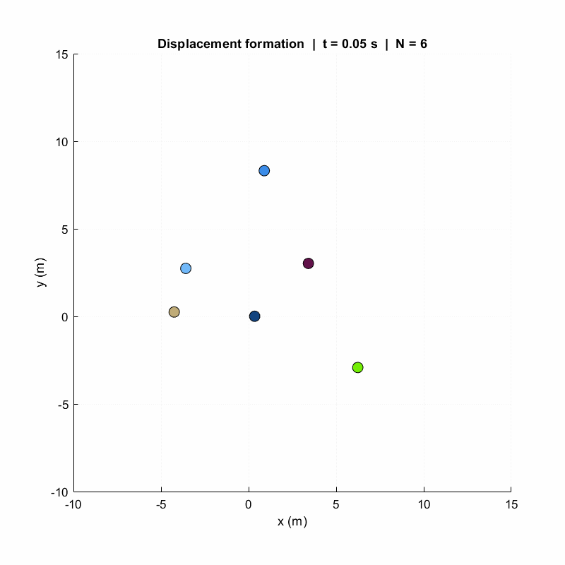
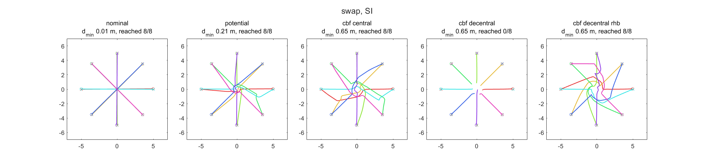
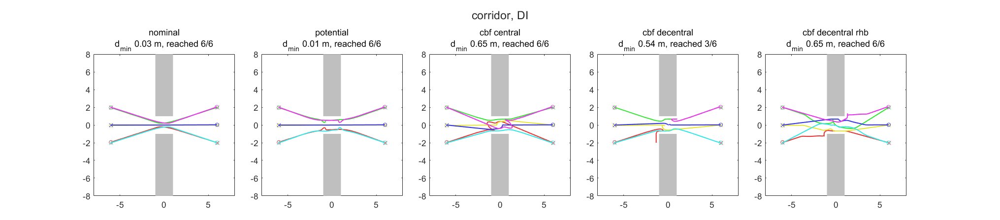
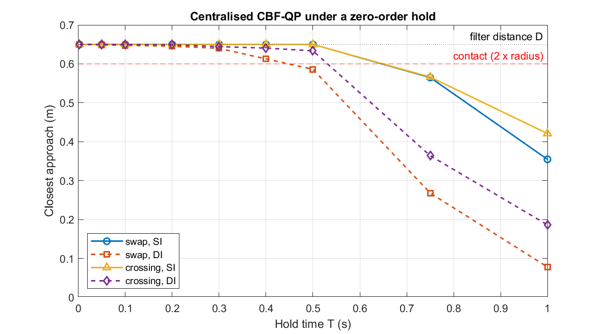

<h1 align="center">SafeSwarm</h1>

<p align="center">
  Safe multi-robot control in MATLAB: drop robots with bounded inputs into a scene,
  pick a controller, wrap it in a control barrier function safety filter, and measure
  what actually happens.
  <br>
  Grown from my <a href="https://github.com/Arshiagosh/SwarmSim">SwarmSim</a> simulator.
</p>

<p align="center">
  
  
  
  
</p>

<p align="center">
  
  &nbsp;
  
</p>

<p align="center"><sub>
  Left: eight robots swap to the opposite side of a circle through the centralised CBF-QP filter.
  Right: displacement-based formation of six double integrators over a ring graph.
</sub></p>

---

## What's in here

SafeSwarm keeps SwarmSim's layered design (dynamics → swarm and engine → behaviours and
planners → tools) and adds what a safety study needs:

- **Explicit input bounds.** Single integrator (‖u‖ ≤ v<sub>max</sub>), double integrator
  (‖u‖ ≤ a<sub>max</sub>, optional speed limit) and unicycle (box on v, ω). Every model has an
  exact zero-order-hold step and a control-affine form ẋ = f(x) + g(x)u for the filters.
- **Collisions are measured, not hidden.** SwarmSim pushed robots out of walls and obstacles. Here
  `contact_mode = 'none'` leaves the state alone and the logger records the closest approach,
  obstacle clearance, collision steps and control effort.
- **A CBF-QP safety filter** (`safety/SafetyFilter.m`) that wraps any behaviour:
  - pairwise and obstacle barriers h = ‖p<sub>i</sub> − p<sub>j</sub>‖² − D²,
  - relative degree one for the single integrator, a high-order CBF (Xiao and Belta, 2019) plus a
    speed barrier for the double integrator, and a look-ahead point for the unicycle,
  - **centralised** (one QP) or **decentralised** (one QP per robot, each keeping half of every
    pairwise constraint, after Wang, Ames and Egerstedt, 2017),
  - input bounds as hard constraints, and an explicit infeasibility count: when the bounds and the
    barriers conflict, the QP is solved again with a slack and the step is logged. It never falls
    back to the nominal command silently.
- **A sampled-data mode** in the engine: the controller runs every T seconds and its command is
  held while the dynamics keep integrating, to see what a continuous-time certificate is worth
  on a digital controller.
- **Benchmarks** (swap, crossing, corridor) that write `results.json` and every figure in this
  README from a script.

The maths is on one page in [docs/SAFETY.md](docs/SAFETY.md).

## Results

All numbers below come from `experiments/e1_benchmarks.m` and `experiments/e2_sampled_sweep.m`
(MATLAB R2023b) and are stored in [results.json](results.json). Robots have radius 0.3 m, so they
touch at 0.6 m; the filter keeps D = 0.65 m between centres. Speeds are bounded by 1 m/s and
accelerations by 1 m/s². Starts get a 5 cm random offset (seed 1) to break exact symmetry.

### E1: five controllers on three scenes

<p align="center">
  
  
</p>

Closest approach (m) and whether every robot reached its goal within 40 s:

| Scene | Dynamics | Nominal | Potential field | CBF centralised | CBF decentralised | CBF decentralised + right-hand bias |
|---|---|---|---|---|---|---|
| Swap (8) | SI | 0.006, all | 0.208, all | 0.650, all | 0.650, **0 of 8** | 0.650, all |
| Swap (8) | DI | 0.006, all | 0.005, all | 0.649, all | 0.641, all | 0.650, all |
| Crossing (8) | SI | 0.024, all | 0.156, all | 0.650, all | 0.650, all | 0.885, all |
| Crossing (8) | DI | 0.024, all | 0.025, all | 0.650, all | 0.650, all | 0.885, all |
| Corridor (6) | SI | 0.021, all | 0.111, all | 0.651, all | 0.650, **0 of 6** | 0.654, all |
| Corridor (6) | DI | 0.030, all | 0.008, all | 0.650, all | **0.536**, 3 of 6 | 0.650, all |

What the table says:

- The nominal go-to-goal controller and SwarmSim's potential field both collide in every scene.
  The potential field's gains were not tuned per scene, so treat it as a reference point, not a
  best effort.
- The centralised filter kept D (to within 1 mm) in every case and every robot arrived, at the cost of a longer
  trip (for example 13.3 s instead of 10.6 s for the single-integrator swap).
- **Deadlock.** The decentralised filter is safe but in the symmetric swap and in the corridor the
  single-integrator robots stop short of their goals with every constraint satisfied. The
  right-hand-bias heuristic (an extra sideways push on the nominal command when another robot is
  near) got them all through in these runs. It is a heuristic, not a guarantee.
- **Infeasibility is real.** With a 1 m/s² bound the decentralised double-integrator filter could
  not satisfy its constraints on 66 steps in the swap and 84 in the corridor. In the corridor that
  ended in contact: the closest approach was 0.536 m and 50 logged steps had two robots overlapping.
  The centralised filter had no infeasible steps in E1.

Mean filter time per control step was 7 to 15 ms for the centralised filter (one QP over up to
16 variables) and 3 to 6 ms for all the decentralised QPs together, on my laptop.

### E2: the same filter on a digital controller

<p align="center">
  
</p>

The CBF condition is written for a command that changes continuously. Holding each command for
T seconds (dynamics integrated at 2 ms) and changing nothing else:

- single integrator: the closest approach stayed at D for T up to 0.5 s and dropped to 0.36 m (swap)
  and 0.42 m (crossing) at T = 1 s;
- double integrator: it started to fall earlier, 0.613 m at T = 0.4 s in the swap, contact at
  T = 0.5 s (0.586 m), and 0.078 m at T = 1 s.

So the certificate depends on the sampling period and nothing in a standard CBF-QP filter
accounts for it. My MSc thesis works on exactly this; that part is not in this repository yet.

## Running it

MATLAB R2023b (older releases will probably work but are untested). The core needs base MATLAB;
`SafetyFilter` needs the Optimization Toolbox (`quadprog`) and says so if it is missing.

```matlab
cd SafeSwarm
startup                                  % adds everything to the path
run('scenarios/scenario_swap_cbf.m')     % swap with and without the filter, prints the closest approach
run('tests/run_tests.m')                 % 31 unit tests
run('experiments/e1_benchmarks.m')       % E1 table, figures and swap GIF (a few minutes)
run('experiments/e2_sampled_sweep.m')    % E2 sweep (takes longer: 2 ms steps)
```

A filter around your own behaviour:

```matlab
nominal = GoToGoal(goals);                               % or Flocking, DisplacementFormation, ...
safe    = SafetyFilter(nominal, 'Mode', 'decentralised');
sim     = SimEngine(swarm, env, safe, 0.05, 30);
sim.contact_mode   = 'none';                             % keep collisions visible
sim.control_period = 0.2;                                % optional zero-order hold
sim.logger         = DataLogger();
sim.run();
sim.logger.summary()                                     % closest approach, collisions, effort
safe.n_infeasible                                        % steps where the QP needed slack
```

The SwarmSim scenarios (`scenarios/scenario_*.m`) still run unchanged:
`run('tests/run_all_scenarios.m')`.

## Repository layout

```
dynamics/       SingleIntegrator, DoubleIntegrator, Unicycle (bounds, exact steps, f and g)
core/           Agent, Swarm, Environment, DynamicObstacle, CommChannel, SimEngine, DataLogger
behaviours/     SwarmSim behaviours + DisplacementFormation, GoToGoal, FunctionBehaviour
planners/       AStar, RRT, PotentialField
safety/         SafetyFilter (CBF-QP, centralised and decentralised)
tools/          MetricsAnalyzer, ExperimentRunner, ParamSweep, PublicationPlot
visualization/  SwarmVisualizer (with GIF export)
scenarios/      runnable examples
experiments/    E1 and E2; each writes figures/ and results.json
tests/          matlab.unittest suites, run_tests.m, run_all_scenarios.m
docs/           SAFETY.md
```

## Changes from SwarmSim

Besides the new parts above, porting the core turned up a few things that are fixed here
(SwarmSim itself is unchanged):

- `PathFollowing` could pick a waypoint behind the robot and turn it around.
- `VirtualStructure` advanced its centre by a hard-coded 0.05 s per call (only right for
  dt = 0.05) and had no velocity damping for double integrators, so robots oscillated about their
  slots.
- The double integrator used a semi-implicit Euler step; it is now the exact zero-order-hold
  solution.

## Limitations and what's next

- Deadlock and infeasibility are reported, not solved.
- Barriers on rectangles use the closest point, which is not smooth at corners.
- The swap and crossing scenes are small (6 to 8 robots) and the results are single seeded runs,
  not Monte Carlo averages.

Next on the list: sensor noise, packet drop, latency and faults with a Monte Carlo runner; a
nonlinear MPC planner and a learned residual model compared with the filter; a ROS 2 bridge; then
a Python port in `python/`.

## References

- A. D. Ames, S. Coogan, M. Egerstedt, G. Notomista, K. Sreenath and P. Tabuada, "Control barrier
  functions: theory and applications", *European Control Conference*, 2019.
- L. Wang, A. D. Ames and M. Egerstedt, "Safety barrier certificates for collisions-free multirobot
  systems", *IEEE Transactions on Robotics* 33(3), 2017.
- W. Xiao and C. Belta, "Control barrier functions for systems with high relative degree",
  *IEEE Conference on Decision and Control*, 2019.
- K.-K. Oh, M.-C. Park and H.-S. Ahn, "A survey of multi-agent formation control",
  *Automatica* 53, 2015.
- C. W. Reynolds, "Flocks, herds and schools: a distributed behavioral model", *SIGGRAPH*, 1987.

## License

MIT, see [LICENSE](LICENSE).

---

Arshia Goshtasbi · MSc Electrical Engineering (Control), Iran University of Science and Technology
